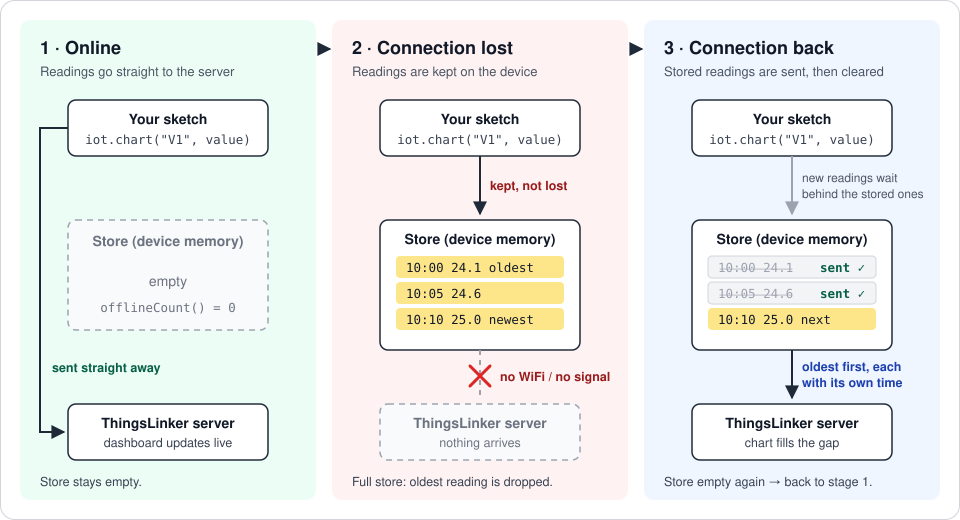

```
  _______ _     _                 _ _       _
 |__   __| |   (_)               | (_)     | |
    | |  | |__  _ _ __   __ _ ___| |_ _ __ | | _____ _ __
    | |  | '_ \| | '_ \ / _` / __| | | '_ \| |/ / _ \ '__|
    | |  | | | | | | | | (_| \__ \ | | | | |   <  __/ |
    |_|  |_| |_|_|_| |_|\__, |___/_|_|_| |_|_|\_\___|_|
                         __/ |
                        |___/
```

# ThingsLinker — Arduino Library for ESP32

[](https://github.com/Thingslinker-Organization/ThingsLinker-Arduino-Library)
[](LICENSE)
[](https://www.espressif.com/en/products/socs/esp32)

Connect your ESP32 to the ThingsLinker IoT platform in just **3 lines of code**.

Two variants in one library:

| Variant | Class | Connectivity | Use when |
|---------|-------|-------------|----------|
| **WiFi** | `ThingsLinker` | WiFi (BLE provisioning) | Device is near a router |
| **GSM** | `ThingsLinkerGSM` | 4G LTE via Simcom A7672 | Device is mobile or remote |

Both use the **exact same widget API** — `gauge()`, `onSwitch()`, `run()` etc. work identically in both.

---

## Table of Contents

- [WiFi Variant — ThingsLinker](#wifi-variant--thingslinker)
  - [Quick Start](#quick-start-wifi)
  - [Widget Examples (WiFi)](#widget-examples-wifi)
- [GSM Variant — ThingsLinkerGSM](#gsm-variant--thingslinkergsmm)
  - [Quick Start (GSM)](#quick-start-gsm)
  - [Widget Examples (GSM)](#widget-examples-gsm)
  - [GPS Tracker](#gps-tracker)
- [OTA Firmware Updates](#ota-firmware-updates)
- [Offline Storage](#offline-storage)
- [Storage API](#storage-api)
- [Quick Reference](#quick-reference)
- [Troubleshooting](#troubleshooting)

---

## WiFi Variant — ThingsLinker

### Quick Start (WiFi)

**Step 1 — Install dependencies** (Arduino Library Manager):
- **ArduinoJson** ≥ 7.4.3
- **PubSubClient** ≥ 2.8

**Step 2 — Get your credentials** from the Organisation Portal:
`Blueprints → [Blueprint] → Devices → [Device]`
- **Auth Token** — long hex string
- **Blueprint Key** — starts with `BLUE`
- **Client Key** and **Secret Key**

**Step 3 — Upload:**

```cpp
#include <ThingsLinker.h>

ThingsLinker iot("YOUR_AUTH_TOKEN", "YOUR_BLUEPRINT_KEY");

void setup() {
  Serial.begin(115200);
  iot.begin("YOUR_CLIENT_KEY", "YOUR_SECRET_KEY");
}

void loop() {
  iot.run();
}
```

**First boot:** BLE starts automatically. Open the ThingsLinker app → find your device → enter WiFi credentials.
**Every boot after:** Connects to WiFi and MQTT automatically.

---

### Widget Examples (WiFi)

#### Gauge — Send a sensor value

```cpp
#include <ThingsLinker.h>

ThingsLinker iot("YOUR_AUTH_TOKEN", "YOUR_BLUEPRINT_KEY");

void setup() {
  Serial.begin(115200);
  iot.begin("YOUR_CLIENT_KEY", "YOUR_SECRET_KEY");
}

void loop() {
  iot.run();

  static unsigned long last = 0;
  if (millis() - last >= 3000) {
    last = millis();

    float temperature = 25.0;          // replace with real sensor
    iot.gauge("V1", temperature);      // → Gauge widget on V1
  }
}
```

---

#### Chart — Live graph with history

```cpp
void loop() {
  iot.run();

  static unsigned long last = 0;
  if (millis() - last >= 5000) {
    last = millis();

    float humidity = 60.0;             // replace with real sensor
    iot.chart("V1", humidity);         // → Chart widget on V1
  }
}
```

---

#### Switch — App controls a relay

```cpp
#include <ThingsLinker.h>

ThingsLinker iot("YOUR_AUTH_TOKEN", "YOUR_BLUEPRINT_KEY");

#define RELAY_PIN 4

void setup() {
  Serial.begin(115200);
  pinMode(RELAY_PIN, OUTPUT);

  iot.begin("YOUR_CLIENT_KEY", "YOUR_SECRET_KEY");

  iot.onSwitch("V1", [](bool on) {          // Switch widget on V1
    digitalWrite(RELAY_PIN, on ? HIGH : LOW);
    Serial.println(on ? "Relay ON" : "Relay OFF");
  });
}

void loop() {
  iot.run();
}
```

---

#### Slider — App controls brightness

```cpp
iot.onSlider("V1", [](float value) {        // Slider widget on V1 (0–100)
  int brightness = (int)(value * 2.55f);    // 0–100 → 0–255
  analogWrite(LED_PIN, brightness);
});
```

---

#### Button — App triggers an action

```cpp
iot.onButton("V1", [](bool pressed) {       // Button widget on V1
  if (pressed) {
    // do something when button is tapped in app
    Serial.println("Button tapped!");
  }
});
```

---

#### RGB — App controls LED strip color

```cpp
iot.onRGB("V1", [](uint8_t r, uint8_t g, uint8_t b,
                    bool on, uint16_t count, const char* pattern) {
  // r, g, b   = color (0–255 each)
  // on         = strip on or off
  // count      = number of LEDs (set in app)
  // pattern    = effect name e.g. "Solid", "Blink"

  Serial.printf("Color: R%d G%d B%d  On:%s\n", r, g, b, on ? "yes" : "no");
  // drive your NeoPixel / FastLED strip here
});
```

---

#### Joystick — App controls direction

```cpp
iot.onJoystick("V1", [](float x, float y) {
  // x: left (−1.0) to right (+1.0)
  // y: back (−1.0) to forward (+1.0)

  if      (y >  0.5) Serial.println("FORWARD");
  else if (y < -0.5) Serial.println("BACKWARD");
  else if (x >  0.5) Serial.println("RIGHT");
  else if (x < -0.5) Serial.println("LEFT");
  else               Serial.println("STOP");
});
```

---

#### Map — Send GPS location

```cpp
float lat = 23.0225, lng = 72.5714;   // from your GPS module
iot.map("V1", lat, lng);              // → Map widget on V1
```

---

#### LED — Show alarm state in app

```cpp
bool alarm = (temperature > 35.0);
iot.led("V1", alarm);                 // → LED widget turns red/green
```

---

#### Status — Show a value as a named state

The states (label, colour, icon and which values each one covers) are set up in the portal. The device only sends the raw value, as a number or as text.

```cpp
iot.status("V1", level);              // number → the state whose range covers it
iot.status("V2", "ERR");              // text   → the state set to exactly "ERR"
```

---

#### Progress Bar — Show a value as a filled bar

```cpp
iot.progress("V1", 63);               // the bar's min and max are set in the portal
```

---

#### Selector — App picks one of several options

Each option has a label the user sees and a value the device receives. Use `onSelector()` when the values are numbers and `onSelectorText()` when they are text.

```cpp
void setup() {
  iot.begin("YOUR_CLIENT_KEY", "YOUR_SECRET_KEY");

  iot.onSelector("V1", [](float option) {          // options with values 0, 1, 2
    Serial.printf("Mode: %d\n", (int)option);
  });

  iot.onSelectorText("V2", [](const char* option) { // options with values "eco", "max"
    if (strcmp(option, "eco") == 0) Serial.println("Eco mode");
  });
}

// When the device changes the option by itself, show it in the app:
iot.selector("V1", 2);
```

---

#### Number Input — App sends an exact number

```cpp
iot.onNumberInput("V1", [](float setpoint) {   // typed, or stepped with − and +
  Serial.printf("Set point: %.1f\n", setpoint);
});

iot.numberInput("V1", 21.5f);                  // show the device's own value in the app
```

---

#### Text Input — App sends a line of text

```cpp
iot.onTextInput("V1", [](const char* text) {
  Serial.printf("Received: %s\n", text);       // copy the text if you need it later
});
```

---

#### Keypad — App sends a command per button

Each button sends its own value on every press, including the same button twice in a row. Use `onKeypad()` when the values are numbers and `onKeypadText()` when they are text.

```cpp
iot.onKeypadText("V1", [](const char* key) {
  if      (strcmp(key, "start") == 0) Serial.println("Start");
  else if (strcmp(key, "stop")  == 0) Serial.println("Stop");
});
```

Each press is delivered once and is not repeated when the device reconnects.

---

#### Widgets that need no device code

These widgets are built in the dashboard from the pins your device already uses. Add them in the portal; there is nothing to write in the sketch.

| Widget | What it shows |
|--------|---------------|
| Computed Value | A number worked out from other pins, e.g. `V0 * V1` |
| Multi Chart | Several pins on one chart |
| Event Log | A running list of the values received on chosen pins |
| Table | Every widget's current value in one list |
| Text | A heading or a note |

---

## GSM Variant — ThingsLinkerGSM

Use this when your device needs to work **without WiFi** — on the road, in the field, or anywhere with a 4G signal.

**Required hardware:**
- ESP32 (any variant)
- Simcom **A7672SA / A7672E / A7672S** (or SIM7672) 4G LTE modem

**Required library:** Only **ArduinoJson** — no TinyGSM, no PubSubClient needed.

### Wiring

```
ESP32 GPIO16 (RX2) ──── A7672 TX
ESP32 GPIO17 (TX2) ──── A7672 RX
ESP32 GPIO4        ──── A7672 PWRKEY
External 4V/500mA  ──── A7672 VCC
GND                ──── A7672 GND
```

---

### Quick Start (GSM)

```cpp
#include <ThingsLinkerGSM.h>

ThingsLinkerGSM iot(Serial2, "YOUR_AUTH_TOKEN", "YOUR_BLUEPRINT_KEY");

// ── Option A: PWRKEY wired to a GPIO ─────────────────────────────────────────
#define MODEM_PWR_PIN  4          // GPIO 4 → A7672 PWRKEY

// ── Option B: PWRKEY not connected (modem powers on automatically) ────────────
// #define MODEM_PWR_PIN  TL_NO_PWRKEY

void setup() {
  Serial.begin(115200);
  Serial2.begin(115200, SERIAL_8N1, 16, 17);    // RX=16, TX=17

  iot.begin("YOUR_CLIENT_KEY", "YOUR_SECRET_KEY",
            "airtelgprs.com",   // your SIM card APN
            MODEM_PWR_PIN);     // pass pin number OR TL_NO_PWRKEY
}

void loop() {
  iot.run();
}
```

That's it. The library handles modem power-on, network registration, SSL, MQTT connect, and auto-reconnect automatically.

**PWRKEY — which option do I use?**

| Situation | Define |
|-----------|--------|
| PWRKEY wired to an ESP32 GPIO (e.g. GPIO 4) | `#define MODEM_PWR_PIN 4` |
| PWRKEY not connected — modem auto-starts when power is applied | `#define MODEM_PWR_PIN TL_NO_PWRKEY` |
| PWRKEY tied directly to VCC on the breakout board | `#define MODEM_PWR_PIN TL_NO_PWRKEY` |

**Common APNs:**
| Carrier | APN |
|---------|-----|
| Airtel India | `airtelgprs.com` |
| Jio India | `jionet` |
| Vodafone India | `www` |
| AT&T US | `phone` |
| T-Mobile US | `fast.t-mobile.com` |

---

### Widget Examples (GSM)

Every widget function is **identical** to the WiFi variant — just use `ThingsLinkerGSM` instead of `ThingsLinker`.

#### Gauge — Send a sensor reading

```cpp
#include <ThingsLinkerGSM.h>

ThingsLinkerGSM iot(Serial2, "YOUR_AUTH_TOKEN", "YOUR_BLUEPRINT_KEY");

void setup() {
  Serial.begin(115200);
  Serial2.begin(115200, SERIAL_8N1, 16, 17);
  iot.begin("YOUR_CLIENT_KEY", "YOUR_SECRET_KEY", "airtelgprs.com", 4);
}

void loop() {
  iot.run();

  static unsigned long last = 0;
  if (millis() - last >= 5000) {
    last = millis();

    float temperature = 28.5;          // replace with real sensor
    iot.gauge("V1", temperature);      // → Gauge widget on V1

    Serial.println("Sent: " + String(temperature) + " °C");
  }
}
```

---

#### Switch — App controls a relay over 4G

```cpp
#include <ThingsLinkerGSM.h>

ThingsLinkerGSM iot(Serial2, "YOUR_AUTH_TOKEN", "YOUR_BLUEPRINT_KEY");

#define RELAY_PIN 26

void setup() {
  Serial.begin(115200);
  Serial2.begin(115200, SERIAL_8N1, 16, 17);
  pinMode(RELAY_PIN, OUTPUT);

  iot.begin("YOUR_CLIENT_KEY", "YOUR_SECRET_KEY", "airtelgprs.com", 4);

  iot.onSwitch("V1", [](bool on) {              // Switch widget on V1
    digitalWrite(RELAY_PIN, on ? HIGH : LOW);
    Serial.println(on ? "Relay ON" : "Relay OFF");
  });
}

void loop() {
  iot.run();
}
```

---

#### Multiple widgets — Temperature + Humidity + Relay

```cpp
#include <ThingsLinkerGSM.h>

ThingsLinkerGSM iot(Serial2, "YOUR_AUTH_TOKEN", "YOUR_BLUEPRINT_KEY");

#define RELAY_PIN 26

void setup() {
  Serial.begin(115200);
  Serial2.begin(115200, SERIAL_8N1, 16, 17);
  pinMode(RELAY_PIN, OUTPUT);

  iot.begin("YOUR_CLIENT_KEY", "YOUR_SECRET_KEY", "airtelgprs.com", 4);

  iot.onSwitch("V3", [](bool on) {
    digitalWrite(RELAY_PIN, on ? HIGH : LOW);
  });
}

void loop() {
  iot.run();

  static unsigned long last = 0;
  if (millis() - last >= 10000) {
    last = millis();

    float temp = 26.5;     // replace with DHT22 / DS18B20 etc.
    float hum  = 62.0;

    iot.gauge("V1", temp);   // Gauge widget — temperature
    iot.gauge("V2", hum);    // Gauge widget — humidity
    iot.chart("V4", temp);   // Chart widget — temperature history
  }
}
```

---

#### Status, Selector, Number Input, Keypad over 4G

The newer widgets use the same functions as the WiFi class. Register the callbacks before `begin()`.

```cpp
void setup() {
  Serial2.begin(115200, SERIAL_8N1, 16, 17);

  iot.onSelector("V1", [](float option) {
    Serial.printf("Mode: %d\n", (int)option);
  });
  iot.onNumberInput("V2", [](float setpoint) {
    Serial.printf("Set point: %.1f\n", setpoint);
  });
  iot.onKeypadText("V3", [](const char* key) {
    Serial.printf("Key: %s\n", key);
  });

  iot.begin("YOUR_CLIENT_KEY", "YOUR_SECRET_KEY", "airtelgprs.com", MODEM_PWR_PIN);
}

void loop() {
  iot.run();

  static unsigned long last = 0;
  if (millis() - last >= 15000) {
    last = millis();
    iot.status  ("V4", level);     // Status widget — value shown as a named state
    iot.progress("V5", level);     // Progress Bar widget
  }
}
```

See `16_GSM_Dashboard_Widgets` for the complete sketch.

---

#### Check connection status

```cpp
if (iot.mqttConnected()) {
  Serial.println("Connected!");
  Serial.println("IP     : " + iot.getIP());
  Serial.println("Signal : " + String(iot.signalQuality()) + "/31");
}
```

---

### GPS Tracker

The **A7672 has a built-in GPS** — no external GPS module needed. The library handles all communication with the GNSS engine internally.

**Additional wiring:**
```
Active GPS antenna ──── A7672 ANT_GPS connector (uFL / SMA)
```

```cpp
#include <ThingsLinkerGSM.h>

ThingsLinkerGSM iot(Serial2, "YOUR_AUTH_TOKEN", "YOUR_BLUEPRINT_KEY");

void setup() {
  Serial.begin(115200);
  Serial2.begin(115200, SERIAL_8N1, 16, 17);

  iot.begin("YOUR_CLIENT_KEY", "YOUR_SECRET_KEY", "airtelgprs.com", 4);

  iot.startGPS();   // start the built-in GNSS engine
}

void loop() {
  iot.run();   // GPS is polled automatically inside run()

  static unsigned long last = 0;
  if (millis() - last >= 5000) {
    last = millis();

    if (iot.gpsValid()) {
      iot.map    ("V1", iot.gpsLat(), iot.gpsLng());   // Map widget
      iot.gauge  ("V2", iot.gpsSpeed());                // Gauge — speed km/h
      iot.display("V3", iot.gpsAltitude());             // Display — altitude m
      iot.led    ("V4", true);                          // LED — fix locked

      Serial.printf("GPS: %.6f, %.6f  speed=%.1f km/h\n",
                    iot.gpsLat(), iot.gpsLng(), iot.gpsSpeed());
    } else {
      iot.led("V4", false);                             // LED — searching
      Serial.println("GPS: searching for fix...");
    }
  }
}
```

**GPS functions:**

| Function | Returns | Description |
|----------|---------|-------------|
| `iot.startGPS()` | — | Power on GNSS engine (call once in setup) |
| `iot.gpsValid()` | `bool` | `true` when fix acquired |
| `iot.gpsLat()` | `float` | Latitude in decimal degrees |
| `iot.gpsLng()` | `float` | Longitude in decimal degrees |
| `iot.gpsSpeed()` | `float` | Speed in km/h |
| `iot.gpsAltitude()` | `float` | Altitude in metres |

> **Note:** First GPS fix can take 30–90 seconds outdoors with a clear sky view. `gpsValid()` returns `false` until the fix is acquired.

---

## OTA Firmware Updates

Update your device firmware wirelessly — no USB cable needed.

```cpp
#include <ThingsLinker.h>   // or <ThingsLinkerGSM.h>

// ... iot.begin() in setup() ...

void loop() {
  iot.run();

  static unsigned long lastOTA = 0;
  if (millis() - lastOTA >= 300000UL) {    // check every 5 minutes
    lastOTA = millis();

    OTAResult r = iot.checkOTA();

    if (r == OTA_NO_UPDATE) Serial.println("Firmware up to date");
    if (r == OTA_FAILED)    Serial.println("Update failed — will retry");
    if (r == OTA_ERROR)     Serial.println("Could not reach server");
    // OTA_SUCCESS never reaches here — device restarts automatically
  }
}
```

**Portal setup:**
1. **OTA → New Shipping** — upload your compiled `.bin` file
2. **Set shipment → Live** — devices will detect it on next `checkOTA()`
3. Monitor progress in **OTA → Shipments**

> **Important:** Compile with **Tools → Partition Scheme → Default with OTA**. Use the same partition scheme for every firmware version on a device.

---

## Offline Storage

Keep readings while WiFi or mobile data is unavailable, and send them when the connection is back. One line switches it on or off, in both the WiFi and the GSM variant:

```cpp
iot.offlineStorage(true);    // keep readings while offline
iot.offlineStorage(false);   // default: readings taken offline are dropped
```

Nothing else changes in the sketch. Publish as usual:

```cpp
#include <ThingsLinker.h>   // or <ThingsLinkerGSM.h>

ThingsLinker iot("YOUR_AUTH_TOKEN", "YOUR_BLUEPRINT_ID");

void setup() {
  Serial.begin(115200);
  iot.offlineStorage(true);
  iot.begin("YOUR_CLIENT_KEY", "YOUR_SECRET_KEY");
}

void loop() {
  iot.run();

  static unsigned long last = 0;
  if (millis() - last >= 5000) {
    last = millis();
    iot.chart("V1", readSensor());   // online: sent now — offline: stored, sent later
  }
}
```

### How it works



| Stage | What the library does | `iot.offlineCount()` |
|-------|-----------------------|----------------------|
| **1. Online** | Sends each reading to the server straight away. The store is not used. | `0` |
| **2. Connection lost** | Keeps each reading in the device's memory, together with the time it was taken. Nothing is lost while the store has room. | goes up: `1`, `2`, `3`… |
| **3. Connection back** | Sends the stored readings, oldest first, about 20 a second. Each one is removed from the store as soon as it has been sent. Readings taken during this time wait behind the stored ones, so everything arrives in order. | goes down to `0` |
| **Back to 1** | When the last stored reading has been sent the store is empty and its memory is freed. New readings go straight to the server again. | `0` |

You do not have to do anything for stages 2 and 3. They happen inside `iot.run()`.

**Each reading keeps the time it was taken**, so the dashboard shows it at the right place in the chart and in the history, not at the moment it finally arrived. A reading taken before the device ever knew the time (for example, it was switched on with no connection) gets its time worked out once the clock is set.

**If the connection drops again while stored readings are being sent**, the ones already sent are gone from the store and are not sent twice; the rest stay and go out after the next reconnect.

### What you see in the Serial Monitor

```
[Offline] Storage on — up to 200 readings
[MQTT] ✓ V1 = 24.10                      ← online: sent straight away
[Check] WiFi lost — reconnecting...
[Offline] Stored V1 (1 waiting)          ← offline: kept
[Offline] Stored V1 (2 waiting)
[Offline] Stored V1 (3 waiting)
[MQTT] ✓ Connected!
[Offline] Sending 3 stored readings...   ← back online: sending what was kept
[Offline] ✓ All stored readings sent     ← store is empty again
[MQTT] ✓ V1 = 25.30                      ← back to normal
```

This is typical output on WiFi; other lines appear in between, and the GSM variant words a few of them slightly differently. The arrows are explanations added here and are not printed.

### Functions

| Function | Description |
|----------|-------------|
| `iot.offlineStorage(true)` | Switch on, keeping up to 200 readings |
| `iot.offlineStorage(true, 500)` | Switch on, keeping up to 500 readings |
| `iot.offlineStorage(false)` | Switch off and discard anything still waiting |
| `iot.offlineCount()` | Number of readings waiting to be sent |

### Limits to know about

- **Readings are held in memory (RAM).** They survive a connection loss of any length, but are lost if the device restarts or loses power.
- **When the store is full, the oldest reading is dropped** to make room for the newest. A reading uses about 100 bytes, so the default 200 readings need roughly 20 KB. If free memory runs low, the oldest readings are dropped early so the sketch keeps working.
- **On WiFi, the first seconds of an outage can still be lost.** A reading sent just after the link drops, before the device has noticed, is not stored. The GSM variant confirms each reading with the server, so it does not have this gap.
- **On GSM, every stored reading costs mobile data** when it is finally sent.

See `17_Offline_Storage` (WiFi) and `18_GSM_Offline_Storage` (4G).

---

## Storage API

Persist values to ESP32 flash — survives power-off and reboot.

```cpp
// Save
iot.saveString("device_name", "Sensor-01");
iot.saveInt   ("threshold",   30);
iot.saveFloat ("last_lat",    23.0225);
iot.saveBool  ("alarm_on",    false);

// Load  (second argument = default if key not found)
String name  = iot.getString("device_name", "Unknown");
int    thr   = iot.getInt   ("threshold",   25);
float  lat   = iot.getFloat ("last_lat",    0.0);
bool   alarm = iot.getBool  ("alarm_on",    false);

// Manage
iot.hasKey("threshold");     // → true / false
iot.removeKey("threshold");  // delete one key
iot.clearAllData();          // delete all saved data
```

> Key names must be **≤ 15 characters** (ESP32 NVS limit).

---

## Quick Reference

### All publish functions (Device → App)

| Function | Widget | Description |
|----------|--------|-------------|
| `iot.gauge("V1", value)` | Gauge | Numeric value with dial |
| `iot.chart("V1", value)` | Chart | Value + stores history graph |
| `iot.display("V1", value)` | Value Display | Number, boolean or text |
| `iot.label("V1", value)` | Label | Text label (text, number or boolean) |
| `iot.terminal("V1", text)` | Terminal | Print a line to the terminal |
| `iot.led("V1", true/false)` | LED | On/off indicator |
| `iot.button("V1", true/false)` | Button | Button press state |
| `iot.slider("V1", value)` | Slider | Slider position |
| `iot.map("V1", lat, lng)` | Map | GPS location pin |
| `iot.status("V1", value)` | Status | Number or text, shown as a named state |
| `iot.progress("V1", value)` | Progress Bar | Number shown as a filled bar |
| `iot.selector("V1", value)` | Selector | Which option is active now |
| `iot.numberInput("V1", value)` | Number Input | The current number |
| `iot.publish("Type", "V1", value)` | Any widget type, by its name in the portal | Number, boolean or text |

### Data types

Every widget has a data type, set in the portal under the widget's **Data Type**. The library sends the matching JSON type automatically, based on the type of the value you pass. Nothing is guessed from the content, so `"123"` stays text and `123` stays a number.

| Widget | Data types | Example |
|--------|-----------|---------|
| Button, Switch, LED | Boolean | `iot.led("V1", true)` |
| Slider, Gauge, Chart | Integer, Float | `iot.gauge("V1", 23.5f)` |
| Value Display, Label | Integer, Float, Boolean, String | `iot.display("V1", 42)` / `iot.label("V1", "Door open")` |
| Terminal | String | `iot.terminal("V1", "Boot complete")` |
| Status | Integer, Float, Boolean, String | `iot.status("V1", 82)` / `iot.status("V1", "ERR")` |
| Progress Bar, Number Input | Integer, Float | `iot.progress("V1", 63)` |
| Selector, Keypad | Integer, Float, String | `iot.selector("V1", 2)` / `iot.onKeypadText("V1", cb)` |
| Text Input | String | `iot.onTextInput("V1", cb)` |
| RGB, Timer, Map, Joystick | Structured | `iot.map("V1", lat, lng)` |
| Text, Table, Multi Chart, Computed Value, Event Log | — | No device code |

```cpp
iot.display("V3", 42);                         // Integer  → {"v":42}
iot.display("V3", 23.5f);                      // Float    → {"v":23.5}
iot.display("V3", true);                       // Boolean  → {"v":1}
iot.display("V3", "Running");                  // String   → {"v":"Running"}
iot.label("V4", String("Zone ") + zone);       // Arduino String works too
iot.label("V4", iot.getIP());
```

Text values can be up to roughly 300 characters. Longer values are not sent and an error is logged.

### All subscribe functions (App → Device)

| Function | Widget | Callback receives |
|----------|--------|------------------|
| `iot.onSwitch("V1", cb)` | Switch | `bool on` |
| `iot.onButton("V1", cb)` | Button | `bool pressed` |
| `iot.onLED("V1", cb)` | LED | `bool on` |
| `iot.onSlider("V1", cb)` | Slider | `float value` |
| `iot.onValue("V1", cb)` | Value Display | `float value` |
| `iot.onTerminal("V1", cb)` | Terminal | `const char* text` |
| `iot.onWidget("Selector", "V1", cb)` | Any widget type that sends a number | `float value` |
| `iot.onWidgetText("Selector", "V1", cb)` | Any widget type that sends text | `const char* text` |
| `iot.onSelector("V1", cb)` | Selector with number values | `float option` |
| `iot.onSelectorText("V1", cb)` | Selector with text values | `const char* option` |
| `iot.onNumberInput("V1", cb)` | Number Input | `float value` |
| `iot.onTextInput("V1", cb)` | Text Input | `const char* text` |
| `iot.onKeypad("V1", cb)` | Keypad with number values | `float key` |
| `iot.onKeypadText("V1", cb)` | Keypad with text values | `const char* key` |
| `iot.onRGB("V1", cb)` | RGB | `r, g, b, on, count, pattern` |
| `iot.onTimer("V1", cb)` | Timer | `float seconds` |
| `iot.onJoystick("V1", cb)` | Joystick | `float x, float y` |

A `const char*` passed to a callback is only valid during the callback. Copy it if you need it later.

Up to 20 callbacks of each kind (number, on/off, text) can be registered.

### Settings come back on reconnect, actions do not

The apps ask the server to keep the last command sent to a pin, so a device that was offline gets its settings back when it connects. Whether a command is kept depends on the widget:

| Widget | On reconnect |
|--------|--------------|
| Switch, Button, LED, Slider, Selector, Number Input, RGB, Timer, Joystick | The last command is delivered again, so the device returns to the chosen setting |
| Keypad, Text Input | Nothing is delivered. Each press or line is sent once, so these suit one-off commands such as "start" or "restart" |
| Terminal | The last line typed is delivered again. Do not trigger one-off actions directly from `onTerminal()` |

### The device hears its own messages

When the device publishes to a pin it also listens to with the same widget type (for example `iot.selector("V1", 2)` together with `iot.onSelector("V1", cb)`), its own message comes back and the callback runs with that value. This is harmless as long as the callback does not publish to the same pin again, so never call `iot.selector()` from inside `onSelector()`, `iot.numberInput()` from inside `onNumberInput()`, and so on.

### Status functions

| Function | Returns | Description |
|----------|---------|-------------|
| `iot.mqttConnected()` | `bool` | MQTT broker connected |
| `iot.wifiConnected()` | `bool` | WiFi connected *(WiFi only)* |
| `iot.networkConnected()` | `bool` | GPRS data active *(GSM only)* |
| `iot.getIP()` | `String` | Current IP address |
| `iot.signalQuality()` | `int` | GSM signal 0–31 *(GSM only)* |
| `iot.getChipID()` | `String` | Unique chip ID |

### Virtual Pins

Use `"V0"` through `"V124"` (125 pins total). Assign each pin to a widget in the Organisation Portal dashboard.

---

## Examples

Open via **File → Examples → ThingsLinker** in Arduino IDE:

### WiFi Examples
| Example | Description |
|---------|-------------|
| `00_Connection_Test` | Verify credentials and connectivity |
| `01_SimpleExample` | Minimum working sketch |
| `01_BLE_Provisioning` | BLE provisioning + re-provisioning via BOOT button |
| `02_BLE_Force_Provision` | Always starts in BLE mode |
| `02_LED_Control` | Control LED from app |
| `03_Temperature_Monitor` | Publish sensor to Gauge widget |
| `04_Advanced_Control` | Multiple widgets simultaneously |
| `05_Storage_Example` | Persist settings across reboots |
| `07_All_Widgets_Test` | All widget types in one sketch |
| `08_OTA_Update` | OTA v1.0 base firmware |
| `09_Clear_WiFi` | Erase WiFi credentials and re-provision |
| `10_Full_Feature_Test` | Full publish + subscribe with reconnect |
| `11_OTA_TestFirmware` | OTA v2.0 test firmware (used as the new `.bin`) |
| `15_Dashboard_Widgets` | Status, Progress Bar, Selector, Number Input, Text Input, Keypad |
| `17_Offline_Storage` | Keep readings while WiFi is down and send them later |

### GSM Examples
| Example | Description |
|---------|-------------|
| `12_GSM_Connection` | Basic 4G connection + temperature publish + Switch |
| `13_GSM_Full_Example` | All widgets — Gauge, Chart, Switch, Slider, RGB, Joystick, OTA |
| `14_GSM_GPS_Tracker` | Live GPS tracking with built-in GNSS — Map, speed, altitude |
| `16_GSM_Dashboard_Widgets` | Status, Progress Bar, Selector, Number Input, Text Input, Keypad over 4G |
| `18_GSM_Offline_Storage` | Keep readings while there is no mobile signal and send them later |

---

## Troubleshooting

### WiFi Issues
| Symptom | Fix |
|---------|-----|
| Device not visible in BLE scan | Restart ESP32; check no other BLE client is connected |
| WiFi fails every boot | Confirm SSID is 2.4 GHz; call `iot.resetWiFi()` to re-provision |
| MQTT auth failed (state -1) | Check client key and secret key from portal |
| MQTT connect failed (state -2) | Check internet access; confirm port 8883 is not blocked |

### GSM Issues
| Symptom | Fix |
|---------|-----|
| `Modem not responding` | Check RX/TX wiring, power supply (need 500 mA+), PWRKEY GPIO |
| `Network registration failed` | Check SIM card is inserted; check antenna; check carrier coverage |
| `GPRS activation failed` | Check APN string matches your SIM carrier |
| MQTT connect error 30 | Bad Client Key / Secret Key — verify from portal |
| MQTT connect error 32 | SSL handshake failed — check modem firmware version |
| MQTT connect error 3 | Socket connect failed — check SIM data plan is active |
| Signal quality 99 | No signal — check antenna connection |

**Modem does not start, or starts and stops** — check how the modem's power key is wired. If the ESP32 pin goes straight to the modem's PWRKEY (no transistor), the key is pressed by pulling the pin low; tell the library before `begin()`:

```cpp
iot.setPowerKeyActiveLow(true);
iot.begin(CLIENT_KEY, SECRET_KEY, APN, MODEM_PWR_PIN);
```

The key is only pressed when the modem is not answering, so restarting the ESP32 never switches off a modem that is already running.

**`[MQTT] Connect error 32` (secure handshake failed)** — some modem firmware (seen on an A7672G, firmware A110B04) cannot use a server certificate of the ECDSA kind. The MQTT server then needs an RSA certificate. WiFi devices, browsers and the mobile app work with either kind.

**Readings show the wrong time** — the library sets its clock from an internet time server (UTC) right after the data connection comes up, and does not rely on the modem's own clock. If the Serial Monitor shows `Time server request ... failed`, the time server could not be reached over mobile data.

### GPS Issues
| Symptom | Fix |
|---------|-----|
| `gpsValid()` always false | Move device outdoors with clear sky view; first fix can take 60–90 s |
| GPS never gets fix indoors | Normal — GNSS requires open sky. Use a window or external antenna |
| Speed shows 0 when moving slowly | Normal — GNSS speed is unreliable below ~5 km/h |

### OTA Issues
| Symptom | Fix |
|---------|-----|
| `OTA_ERROR` | Check server URL in `TL_Config.h`; confirm device has internet |
| `OTA_FAILED` | Verify `.bin` is valid; confirm shipment is set to Live |
| "No OTA partition found" | Re-flash via USB with **Tools → Partition Scheme → Default with OTA** |
| "Firmware too large" | Recompile new firmware with same partition scheme as base |

---

## Library Architecture

```
src/
├── TL_Config.h           Central config — broker, pins, timeouts, debug macros
├── TL_Storage.h/.cpp     NVS Preferences wrapper (shared by both variants)
├── TL_OTA.h/.cpp         OTA update via HTTP download + ESP32 flash
├── ThingsLinker.h/.cpp   WiFi variant — BLE provisioning, WiFi, TLS MQTT
├── ThingsLinkerGSM.h/.cpp GSM variant  — native A76XX AT commands, GPS
├── TL_BLE.h/.cpp         BLE provisioning module
├── TL_WiFi.h/.cpp        WiFi connect, NTP, reconnect
├── TL_MQTT.h/.cpp        PubSubClient wrapper (WiFi variant)
└── TL_Base64.h/.cpp      Base64 utility
```

---

## License

MIT — use it however you like.

## Support

- Email: info@thingslinker.com
- Website: https://thingslinker.com
